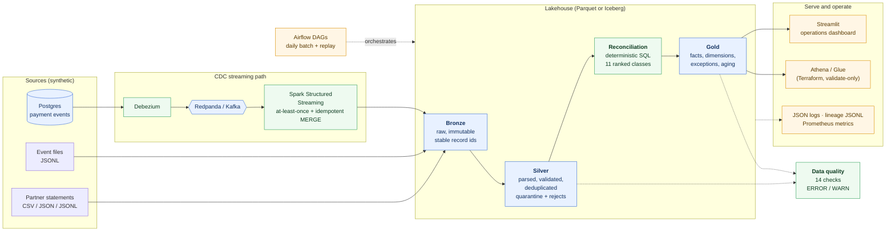

# SettleLake — Cross-Border Payments Data Platform

**The problem.** A payments company records a settlement internally; its partner bank reports the same
settlement on a statement, days later, in another format, sometimes with a mistyped reference, a different
amount, a duplicate, or not at all. Operations teams must find every mismatch, quickly, without ever
guessing a pairing that could hide lost money.

**SettleLake** ingests both sides into a Bronze → Silver → Gold lakehouse, reconciles them with deterministic,
explainable rules, enforces data quality, and serves an operations dashboard. It runs on a laptop
(Python + DuckDB) and on a Spark + Iceberg stack with CDC streaming, Airflow and Terraform, and the two engines are
tested for **exact output parity**.

> **Synthetic data only.** SettleLake does not execute, route or settle real payments and contains no
> real customer or banking data. Every accuracy number below is measured against generated ground truth, not real payments.

## Architecture



| | Local engine (default) | Lakehouse engine |
|---|---|---|
| compute / storage | Python + DuckDB, Parquet files | PySpark 3.5 + Apache Iceberg |
| ingest | JSONL / CSV / JSON files | files **and** Postgres → Debezium → Redpanda → Spark Structured Streaming |
| catalog / object store | paths on disk | Hadoop (tests), JDBC + S3-compatible store (Compose), **AWS Glue + S3** (code path, never applied) |
| orchestration | CLI | CLI and Apache Airflow |

Design points:

- **One set of business rules, two engines.** Record parsing is shared; reconciliation is the same SQL (`reconcile.sql` / `reconcile_spark.sql`).
  A test and a CI job assert the full output tables are identical.
- **Money is integer minor units**, aggregated per currency only; currencies are never summed.
- **Ground truth is separate.** The generator writes labels to a different directory that the pipeline never reads.
- **Idempotent by construction.** Bronze ids are stable (`fingerprint:line`, `cdc:<seq>`); Silver and Gold are pure functions of Bronze
  published atomically (Parquet rename / Iceberg snapshot). Re-runs, resumes and replays produce identical content.
- **Reconciliation refuses to guess.** Exact match key is `PROVIDER|normalised_reference`. A fuzzy fallback (edit distance ≤ 1, same provider,
  currency and amount, within 24 h) only *suggests* a pairing (`REVIEW_REQUIRED`); competing candidates become `AMBIGUOUS_MATCH` and are never paired.

Reconciliation classes, in precedence order: `INVALID_RECORD`, `AMBIGUOUS_MATCH`, `REVIEW_REQUIRED`, `MISSING_INTERNAL_RECORD`,
`MISSING_PARTNER_RECORD`, `CURRENCY_MISMATCH`, `AMOUNT_MISMATCH`, `STATUS_MISMATCH`, `DELAYED_SETTLEMENT` (> 48 h),
`DUPLICATE_EVENT`, `DUPLICATE_STATEMENT`; otherwise `MATCHED`. All applicable reasons are kept; the first is the classification.

## Measured results

All figures are synthetic-data measurements. Spark runs in `local[*]` on one node (no cluster results).

### Throughput (DuckDB engine)

| setup | payments | records | wall time | payments/s | records/s | trials |
|---|---|---|---|---|---|---|
| Linux container | 100k | 489,572 | 20.5 s (median) | 4,877 | 23,874 | 3 |
| Windows host | 100k | | 38.7 s (median) | 2,583 | | 3 |
| Windows host | 500k | | 241 s | 2,075 | 10,153 | 1 |

Host and container are different environments; do not compare them directly. Event-ingestion lag in the synthetic stream is
p50 31 s / p95 58 s / p99 60 s, which is a property of the generator, not pipeline latency.

### DuckDB vs Spark (same container, same data)

| payments | DuckDB (median) | Spark local[*] | reconciliation tables |
|---|---|---|---|
| 10k | 4.6 s | 89.0 s | identical (9,663 rows) |
| 100k | 20.5 s | 108.6 s (1 trial) | identical (96,291 rows) |

Spark was slower at every size on a single node; at 10k most of its time is fixed JVM and Iceberg overhead. This says nothing about multi-node scale-out.

A Spark data-quality bottleneck was found and fixed: three checks written as `NOT IN (subquery)` took **511.6 s** on 100k payments
and 0.62 s as left joins on the same tables, with identical results.

### Reconciliation quality (adversarial held-out seeds 901–903, 15,000 payments)

An independent generator injects cases where a matcher can be wrong (typos, look-alike references, colliding candidates,
a partner booking a payment under another payment's reference). Policy parameters were chosen on development seeds 11–13 only and frozen before the held-out run.

| metric | held-out |
|---|---|
| automatic-match precision | **98.35%** — 182 false automatic matches of 11,024 pairs (1.65%) |
| coverage of resolvable pairs | 92.60% |
| automation rate (internal records auto-paired) | 75.94% |
| competing candidates abstained (`AMBIGUOUS_MATCH`) | 676 / 676 |
| `REVIEW_REQUIRED` recall / precision | 100% / 59.23% (many look-alike suggestions are false) |
| missing-partner records classified exactly / flagged for attention / wrongly paired | 58.01% / 84.08% / 15.92% (of 1,143) |
| unresolved exposure caught, per currency | 94.8–97.1% (e.g. USD 3,403,427.31 falsely cleared) |

All 182 false matches come from one scenario: the partner books payment A's money under payment B's reference with an identical
amount. Every field agrees with a correct match, so it cannot be detected without an independent transaction identifier. These
are reported, not tuned away. The real prevalence of such cases is unknown. The scenario mix is the generator author's choice,
so these numbers are not an estimate of accuracy on real data. Fuzzy automatic matching is disabled because on development data
it raised false automatic matches from 1.5% to about 3.9% of automatic pairs.

An earlier "F1 = 1.0" from the operational generator is a regression check on unambiguous anomalies, not a quality claim.

### Reliability (10k payments)

| scenario | result |
|---|---|
| source-record completeness | 48,966 / 48,966 |
| duplicate deliveries suppressed | 116 / 116 (0 duplicate event ids in Silver) |
| late-arriving events reconciled correctly | 96 / 96 |
| crash at each of 5 stages, then resume | 5 / 5 outputs identical to a clean run (0.9–4.8 s recovery) |
| replay from Bronze | output hashes consistent |
| data-quality checks | 14 / 14 pass |
| streaming crash after MERGE, before offset checkpoint (CI) | 3,937 / 3,937 events exactly once in Bronze |

### Tests and CI

98 pytest tests pass (1 skipped: the Airflow DAG import test, which runs in the Airflow container); non-Spark line coverage 92.5%;
15 Spark/Iceberg parity tests pass. GitHub Actions runs Python 3.11/3.12/3.13 on Linux, 3.13 on Windows, wheel install, Spark parity,
`terraform fmt/validate`, Docker Compose smoke test, the streaming end-to-end proof and the Airflow backfill proof.

## Quick start (local engine, no Docker)

Requires Python 3.11+.

```bash
python -m venv .venv && source .venv/bin/activate      # Windows: .venv\Scripts\activate
pip install -e ".[dev]"

settlelake generate --profile quick --seed 42          # 1,000 payments (demo: 10k, benchmark: 100k)
settlelake run                                         # ingest > silver > reconcile > gold > quality
settlelake report                                      # Markdown summary of the latest run
settlelake dashboard                                   # http://localhost:8501
```

Data lives under `./data` (override with `--home` or `SETTLELAKE_HOME`); it is git-ignored.

| command | purpose |
|---|---|
| `generate --profile quick\|demo\|benchmark --seed N [--anomalies clean\|low\|stress] [--payments N]` | deterministic dataset + separate ground truth |
| `run [--input DIR] [--resume RUN_ID] [--simulate-failure STAGE]` | full pipeline with run/stage tracking |
| `reconcile` / `quality` | re-run reconciliation+gold / data-quality checks |
| `replay --run-id RUN_ID` | re-execute a past run from Bronze into a scratch lake and compare output hashes |
| `evaluate --split dev\|heldout [--sweep]` | adversarial reconciliation evaluation |
| `benchmark --payments N` / `benchmark-suite` / `reliability` | measured benchmarks and failure scenarios |
| `report` / `dashboard` | report, Streamlit UI |

Exit codes: `0` ok, `1` runtime error, `2` usage error, `3` a quality ERROR check failed, `4` replay/parity mismatch.

## Docker

```bash
docker compose up --build dashboard              # MVP: QUICK pipeline into a volume, dashboard on :8501
bash scripts/e2e_stream.sh                       # streaming stack end-to-end proof
bash scripts/e2e_airflow.sh                      # Airflow backfill end-to-end proof
```

Compose profiles: default = MVP; `stream` = Postgres, Debezium/Kafka Connect, Redpanda, SeaweedFS (S3 API), Spark;
`airflow` = Airflow (dev standalone mode) plus the storage services. Credentials in `docker-compose.yml` and
`docker/seaweed/s3.json` are throwaway local-development values. On Windows run the scripts from Git Bash with `MSYS_NO_PATHCONV=1`.

**`scripts/e2e_stream.sh`** loads events into Postgres, lets Debezium capture them, streams them into Iceberg Bronze,
**injects a crash after the MERGE commits but before offsets are checkpointed**, restarts, and asserts exactly one Bronze row per event.
It then builds Silver/Gold on Iceberg, asserts the reconciliation is **identical to the DuckDB engine's**, and asserts nothing changes after re-ingesting everything.

**`scripts/e2e_airflow.sh`** imports the DAGs, runs `airflow dags backfill` over three days, re-runs it with reset, and asserts
the Iceberg tables are unchanged and no quality ERROR check failed.

## AWS

`infra/terraform` defines an S3 lake bucket (versioned, encrypted, private), Glue databases (`bronze|silver|gold|ops`), an Athena
workgroup with saved queries, and a least-privilege IAM role for Spark jobs. `terraform fmt`/`validate` run in CI.
**It has never been applied** (no AWS account or credentials were used), so Glue, Athena and real S3 operation are unverified.

## Guarantees and limits

- **Delivery:** the CDC path is at-least-once with an idempotent MERGE sink, which yields effectively-once Bronze. This is not a general exactly-once claim.
- **Recovery:** the local engine resumes at stage granularity; Spark streaming resumes from its checkpoint. Single-node Compose proves semantics, not horizontal scale-out.
- **Synthetic evaluation only.** Real accuracy is unknown.
- **Scale:** Silver and Gold are full refreshes and Silver holds all records in Python memory, which grows faster than linearly above ~100k payments (500k: 212 of 241 s in Silver).
- **Streaming:** exercised with ~4k events; there is no streaming throughput or lag benchmark. Terraform does not provision Kafka/Redpanda, Debezium or Postgres, and streaming checkpoints would need durable storage on AWS.
- **Observability:** no Prometheus, Grafana or OpenLineage backend is bundled; metrics (Prometheus text format) and lineage are files.
- **Benchmarks:** single machine, few trials, no warm-up.

## Testing

```bash
ruff check src tests && ruff format --check src tests
pytest --cov=settlelake        # local engine; Spark tests are skipped without pyspark + Java
pip install -e ".[stream]" && bash scripts/install_spark_jars.sh && pytest tests/spark   # needs Java 17
```
